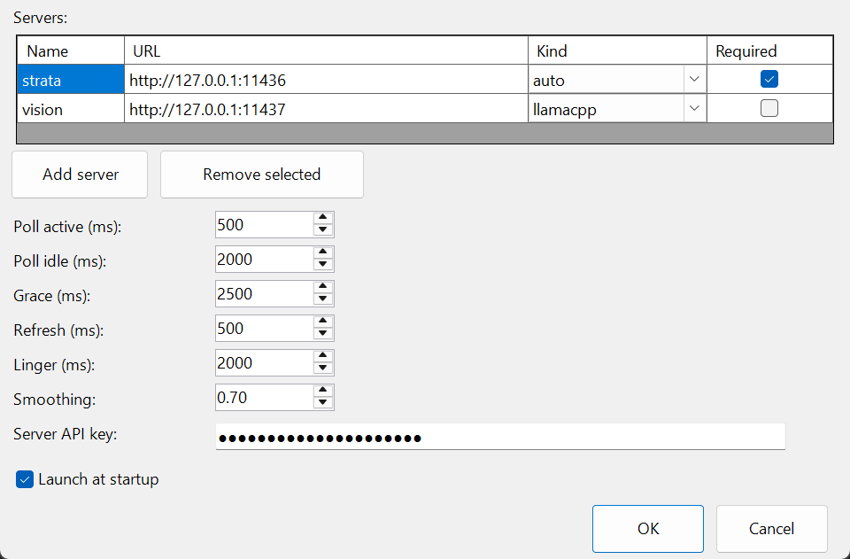

# llamaPeek

**Author:** [lwYeo](https://github.com/lwYeo)

A Windows tray monitor for [llama.cpp](https://github.com/ggml-org/llama.cpp)-compatible inference servers
(llama.cpp, and Strata). Three tiny tray icons give you at-a-glance inference throughput — no window, no web UI,
no logs to tail.

Built with .NET 10 (WinForms, single-file self-contained publish) as a native tray application.


From left: **TG** (decode, tokens/s, badge = active slots) · **PP** (prefill, tokens/s, badge = active slots) ·
**Prefill** (percent, `%` badge) · TG idle (greyed, `--`) · TG with disconnect dot.



## What it can do

- Polls one or more servers (`/metrics` for Strata, `/slots` for llama.cpp) and aggregates across all of them.
- Shows **combined** decode rate (TG), prefill rate (PP), and prefill progress (Prefill %) on three tray icons.
- Badge on TG/PP = number of slots actively decoding/prefilling across all servers.
- Red dot (top-right) on all icons when a server marked **Required** stops answering.
- A failed poll clears that server's rate baselines: after recovery, PP/TG rates re-warm from zero
  (a slot that dies mid-task can never linger in the icons; expect a brief ramp-up after timeouts).
- Running maxima (best TG/PP seen) in the hover tooltip; reset by Restart.
- Auto-detects server type via `/health` (`"service": "strata"` → Strata, else llama.cpp).
- Handles llama.cpp quirks: rates are measured across counter *changes* (not poll intervals, so `--batch-size`
  jumps don't overstate), chunked-prefill totals are detected and the % suppressed per task, router builds
  that need `?model=` get the loaded model auto-discovered (per-server **Model** checkbox).
- API key sent as `Bearer` header; stored only as a DPAPI (current-user) encrypted blob in the registry.
- Launch at startup (HKCU Run key), single instance via mutex, no installer, no admin rights.

## What it cannot do

- **No push** — everything is polling; values update at the configured cadence, not instantly.
- Tooltips are snapshots: Windows renders the tooltip text when it pops up and never refreshes it live.
- llama.cpp's `/slots` has no absolute prefill progress for chunked prompts; the % is then suppressed
  (absolute ingested tokens stay in the tooltip).
- Total prefill for a prompt is only knowable once llama.cpp reports the full size; brief prompts
  (< one chunk) may show PP as `--` for a moment.
- Strata's per-slot `tok_s` lies for batched slots — TG is measured from `generated` deltas instead.
- Icon size is fixed by Windows (16 px × display scale); the app maximizes glyph size inside that.
- Windows-only. No prompts/tokens content is ever read, logged, or stored — only counters.

## How it works

```
ServerRuntime (per server)          Aggregator                     TrayHost
  poll loop, auto-detect kind   ->   per-slot state (server|slot)  ->  paints 3 icons
  exponential backoff on fault       phase inference (PP/TG/Idle)      tooltips, menu
  4 s HTTP timeout                   EMA-smoothed rates, sums,
                                     running maxima
```

- Each server is polled on its own loop: fast cadence while a slot was active within **Grace**, slow cadence
  when idle; faults back off exponentially (capped 10 s) and re-detect the server kind when it returns.
- The aggregator keeps state per slot. A phase is inferred from which counters moved (`prompt_read`/
  `n_prompt_tokens_processed` → prefill, `generated`/`n_decoded` → decode). Rates are EMA-smoothed
  (**Smoothing**), summed across slots in the same phase, and maxima are tracked.
- The tray repaints every **Refresh** ms. PP/TG values **Linger** past idle so phase handovers are readable;
  Prefill retains its last value.
- Settings persist in `HKCU\Software\llamaPeek` (servers as JSON, numeric values clamped on load).

## Menu (identical on all three icons)

| Item | Effect |
|---|---|
| **About** | Version, author, license, and the privacy summary. |
| **Configuration** | Opens the settings dialog (single instance — reopens the existing window). Saving applies immediately (triggers a restart). |
| **Restart** | Re-reads settings, reconnects all servers, resets running maxima and slot baselines. |
| **Exit** | Quits. Icons vanish immediately; poll loops are cancelled as the process exits. |
| **Exit and delete configuration** | Confirmation, then removes all registry state (settings, DPAPI key, Run key) and quits. Program file is left in place. |

## Configuration parameters

| Field | Default | Range | What it affects |
|---|---|---|---|
| **Servers** | empty | — | Name, URL, Kind (`auto`/`llamacpp`/`strata`), **Model** (router builds: `/slots` is queried with `?model=<loaded model>`, auto-discovered via `/v1/models`), **Required** (a required server that stops answering lights the red dot; names must be unique). |
| **Poll active (ms)** | 500 | 100–60 000 | Poll interval while a server shows recent activity. |
| **Poll idle (ms)** | 2000 | 100–60 000 | Poll interval while a server is idle. |
| **Grace (ms)** | 2500 | 0–60 000 | How long recent activity keeps the active cadence. Must be ≥ Linger (enforced). |
| **Refresh (ms)** | 500 | 100–5 000 | How often icons repaint from the aggregated snapshot. |
| **Linger (ms)** | 2000 | 0–60 000 | How long PP/TG keep their last value after going idle (readable handover). |
| **Smoothing** | 0.7 | 0–1 | EMA factor for displayed rates. 0 = frozen, 1 = raw instantaneous, 0.7 = responsive with light damping. |
| **Server API key** | empty | — | Sent as `Bearer` to every server. Stored DPAPI-encrypted (current user); field is masked and copy-disabled. |
| **Launch at startup** | off | — | Writes `HKCU\...\Run\llamaPeek` pointing at the current exe path. Move the exe → re-save. |

## Privacy

llamaPeek is designed for on-prem inference endpoints and reads **counters only**:

- Requests sent to your servers are limited to `GET /health`, `GET /metrics`, `GET /slots`, and
  `GET /v1/models`. No prompt text, completions, tokens, or conversation content is ever read,
  logged, traced, or stored — even though llama.cpp's `/slots` exposes prompt fields, they are not parsed.
- The API key is stored **only** as a DPAPI (current-user scope) encrypted blob under
  `HKCU\Software\llamaPeek`; it is never written in plaintext anywhere, and the settings field is
  masked with copy/cut disabled.
- All configuration lives under the current user's registry (`HKCU`) — no files, no admin rights,
  nothing machine-wide except the optional launch-at-startup Run value.
- No telemetry. The app makes no outbound connections other than to the servers you configure.
- "Exit and delete configuration" removes all persisted state (settings, key, Run key) in one step.

## Versioning

Current version: **0.2.6**. The version is set once in the project files
(`<Version>` in `LlamaPeek.Core.csproj` / `LlamaPeek.Tray.csproj`) and surfaces via
`llamaPeek.exe --version` (also visible on the exe's file properties). Releases are tagged
`v<major>.<minor>.<patch>`.

## Build & publish

Prebuilt binaries: grab `llamaPeek.exe` from the
[Releases](../../releases/latest) page — no SDK needed. Verify with
`SHA256SUMS.txt` (included with each release):

```powershell
Get-FileHash .\llamaPeek.exe -Algorithm SHA256
```

Requires the [.NET 10 SDK](https://dotnet.microsoft.com/download/dotnet/10.0).

```bash
# check the version of a published build
./publish/llamaPeek.exe --version    # -> llamaPeek 0.2.6
```

```bash
# run from source (dev)
dotnet run --project src/LlamaPeek.Tray

# tests
dotnet test

# single self-contained file — no .NET runtime needed on target
dotnet publish src/LlamaPeek.Tray -c Release -r win-x64 --self-contained `
  -p:PublishSingleFile=true -p:IncludeNativeLibrariesForSelfExtract=true `
  -p:EnableCompressionInSingleFile=true -p:InvariantGlobalization=true `
  -p:SatelliteResourceLanguages=en -p:DebugType=none -p:DebugSymbols=false -o publish
```

Result: `publish\llamaPeek.exe` (~47 MB, single file). Copy it anywhere and run; first launch has no servers —
open Configuration from the tray. The bundle is compressed, so the very first launch takes a few seconds to
self-extract (cached afterwards).

## License

MIT — see [LICENSE](LICENSE).
